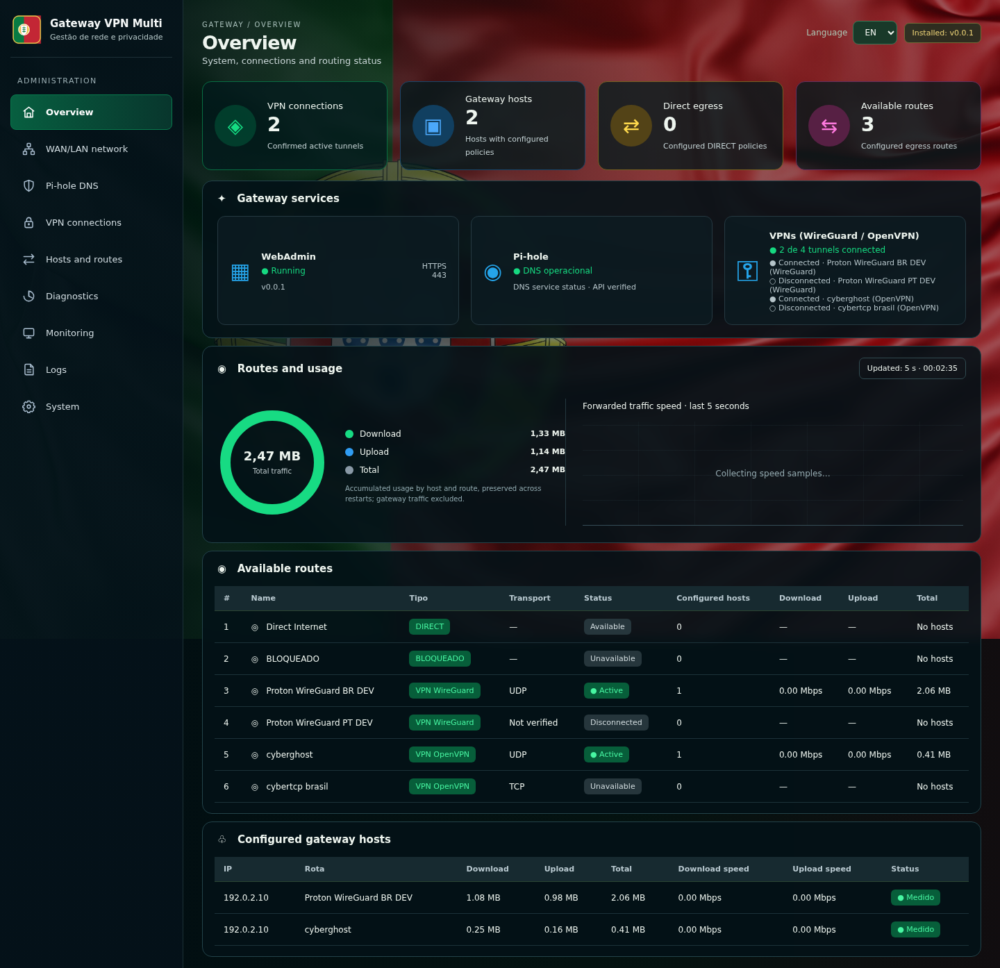
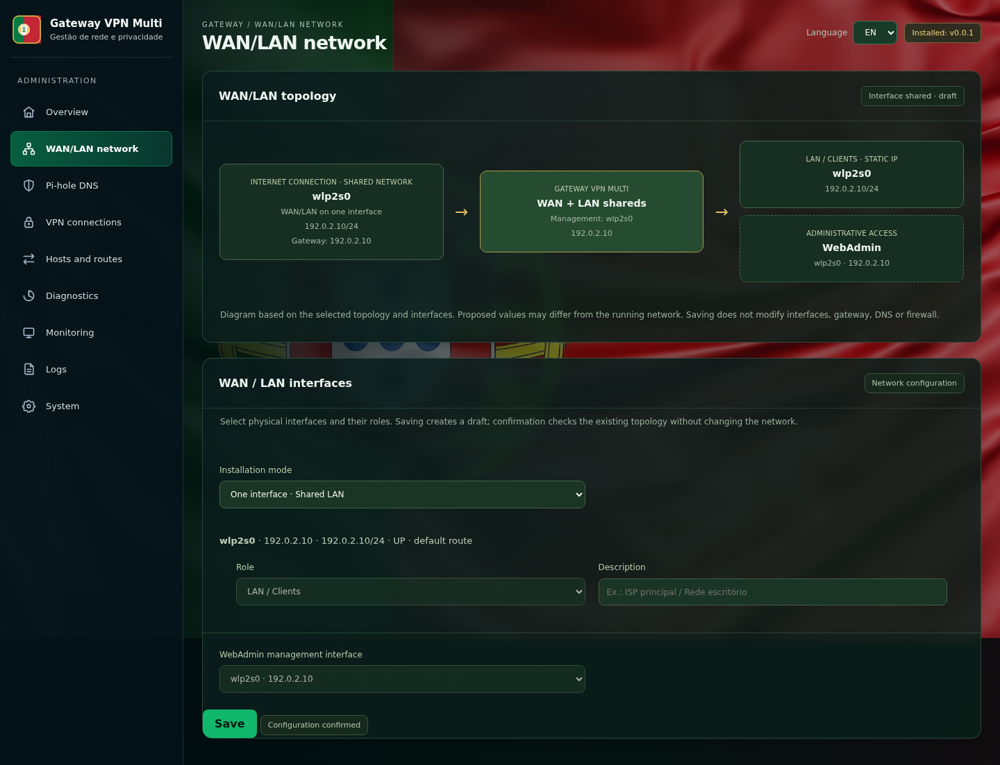
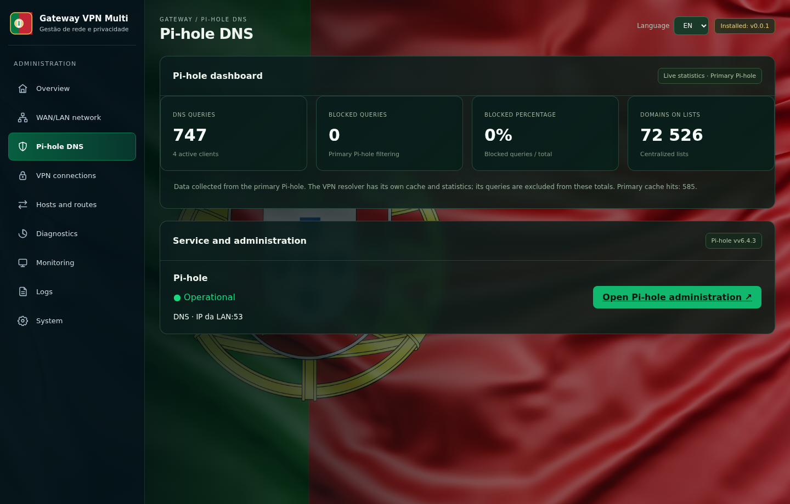
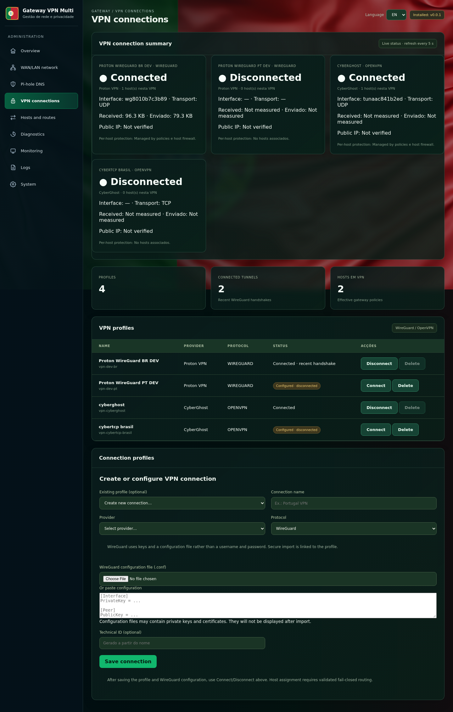
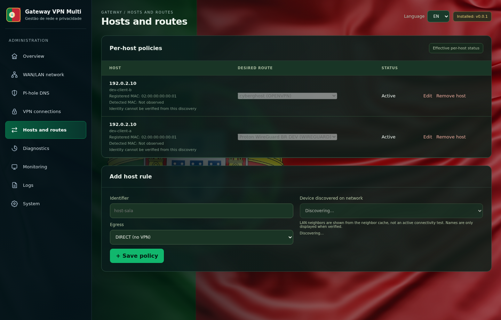
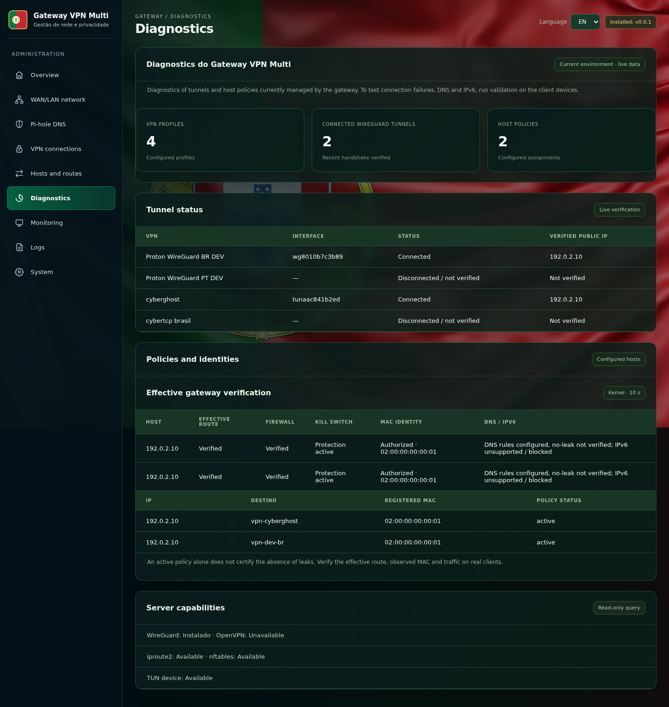
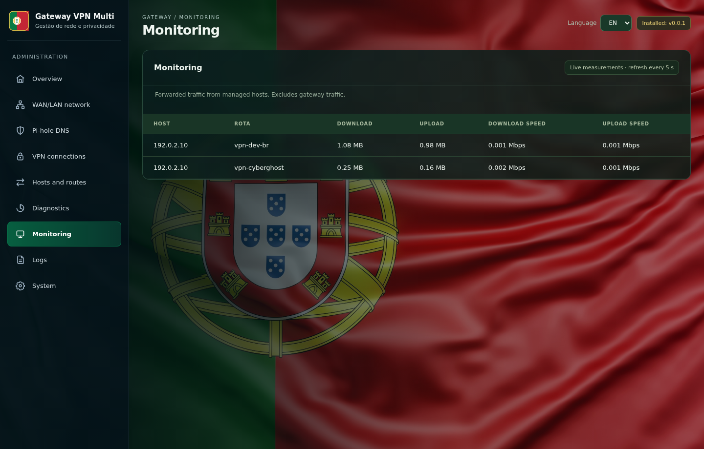
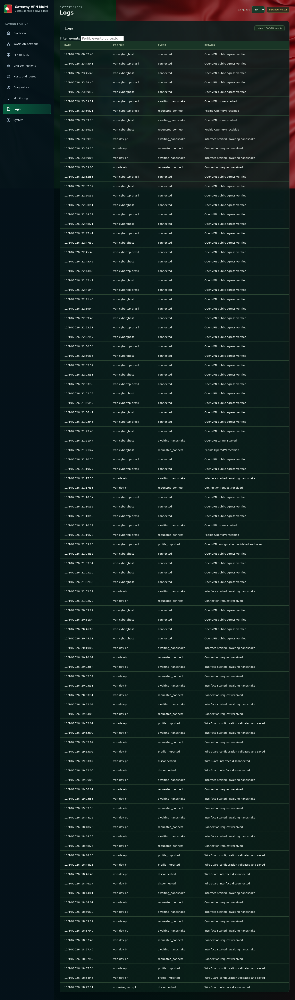
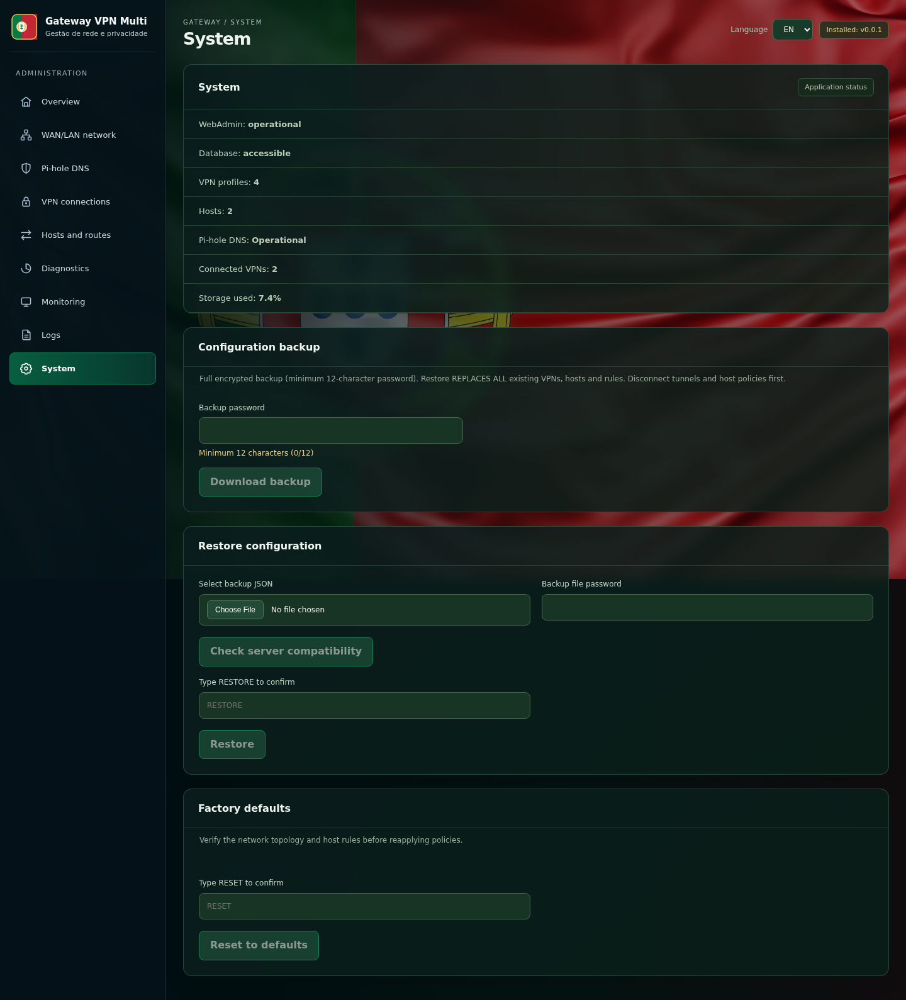

<div align="center">

# Gateway VPN Multi

### Linux IPv4 multi-VPN gateway with per-device routing, Pi-hole and a bilingual WebAdmin

     [](LICENSE)

**Securely route each managed LAN device through its own VPN profile, DIRECT access, or a fail-closed BLOCKED policy.**

[Features](#features) · [Screenshots](#webadmin-gallery) · [Architecture](#architecture) · [Installation](#installation) · [Security](#security-model) · [Recovery](#backup-and-recovery)

</div>

---

<p align="center"></p>

## MediaHub bootstrap compatibility (post-v1.0.5 QA)

The VPN Gateway management IP is configured independently from the LAN's
default router. The host downloads the signed-by-TLS, SHA-256-verified bundle
on HTTPS port 443, while its dedicated authenticated read-only status API
remains on port 9443 once provisioned. See
[MediaHub independent Gateway installation](docs/mediahub-sync-explicit-gateway.md).
The observer is disabled until credentials are provisioned.

## Release estável v1.0.8 — detecção automática do Stremio autorizado

A instalação \`sudo ./start.sh\` publica automaticamente em \`https://IP-LAN:9443\` o serviço Linux de observação NAT-PMP. A API administrativa de consulta continua autenticada por token e não é disponibilizada publicamente.

O novo endpoint \`GET /api/v1/port-forward/authorized-host\` apenas devolve a atribuição **ao próprio host que o Gateway autorizou**, verificando IP de origem, MAC conhecido pelo kernel, política seleccionada e regras de encaminhamento activas. Não entrega tokens ou chaves. A instalação do Stremio \`v0.1.3-rc.9\` consulta este endpoint quando o Gateway coincide com o seu próximo salto predefinido e fixa o certificado TLS no primeiro acesso (TOFU). Alterações inesperadas de certificado são rejeitadas.

**Modelo de confiança:** a admissão baseada em IP/MAC exige uma LAN de gestão controlada com protecção contra ARP/MAC spoofing; TOFU não oferece autenticação forte no primeiro contacto. Não exponha TCP/9443 na WAN nem utilize este modo numa rede partilhada/não confiável. Para redes não confiáveis, mantenha o observador anterior com CA aprovada e token de leitura. O Gateway nunca altera o container nem o \`.env\` do Stremio; a alteração e rollback são responsabilidade exclusiva do reconciliador do host.

**Release:** [v1.0.8](https://github.com/emmanique/vpngateway-webadmin/releases/tag/v1.0.8).

## Release estável v1.0.7 — Pi-hole sem password e estado DNS

A instalação nova configura o Pi-hole v6 **sem password**, para que o WebAdmin consiga consultar versão, DNS e estatísticas através da rede Docker interna. O endpoint DNS é `/api/dns/blocking`; os contadores do dashboard são obtidos de `/api/stats/summary`. O WebAdmin comunica a versão `1.0.7` da distribuição. A configuração `deploy/.env` já existente não é substituída durante upgrades.

**Segurança:** a administração do Pi-hole em `https://IP-DO-GATEWAY:8443/admin/` fica sem autenticação e deve ser acedida **exclusivamente numa LAN de confiança**. Nunca encaminhe/publicite TCP/8443 na WAN. Para um cenário não confiável, definir manualmente uma password e introduzir autenticação de API no Gateway antes de activar esse modo. Esta versão não certifica instalações expostas à Internet.

**Release:** [v1.0.7](https://github.com/emmanique/vpngateway-webadmin/releases/tag/v1.0.7). Consultar [notas de validação](docs/releases/v1.0.7.md).

## Release estável v1.0.6 — instalação e packages

**Release publicada:** [v1.0.6](https://github.com/emmanique/vpngateway-webadmin/releases/tag/v1.0.6), com archives `.zip`, `.tar.gz` e `manifest.json` (SHA-256). Para instalar a partir de código, utilizar a tag `v1.0.6` ou verificar `VERSION=1.0.6` em `main`; as imagens WebAdmin/VPN são construídas localmente a partir da revisão seleccionada. Não utilizar os packages antigos `v1.0.5` como se fossem a revisão actual.

Esta versão corrige os contadores direccionais RX/TX e a contagem de pacotes bloqueados; mantém excepções HTTPS de gestão restritas por host e reconcilia-as após reinícios do agente ou mudanças do proxy Docker. **Validação:** 506 testes + 80 subtestes aprovados, WebAdmin e API HTTPS 200 e políticas da máquina de ensaio verificadas. O router upstream `.1` fica fora do âmbito do software gateway `.235`; o bloqueio aplica-se a tráfego que realmente atravessa o gateway. Consulte [notas da release](docs/releases/v1.0.6.md).

## Release 1.0.5 — MediaHub observer and WebAdmin routing correction

**VPN Gateway Multi 1.0.5** includes per-host UPnP/NAT-PMP port ownership, dynamic Proton port reconciliation, OpenVPN/DNS robustness, independent MediaHub Stremio port synchronisation and a reusable local CI workflow.

**Validation:** local CI is the project's approved quality gate while GitHub-hosted Actions is blocked by usage limits. The selected five jobs cover API, bilingual WebAdmin, VPN and WebAdmin images, and isolated Linux dataplane.

**Scope and safeguards:** standard DNS remains routed to the selected VPN provider. The route-aware Pi-hole central DNS cutover is experimental and opt-in. NAT-PMP lease verification does not prove Internet peer reachability. This release is built from an exact locally validated commit with packages and checksums.

## Features

| Area | Capabilities |
|---|---|
| **Per-host IPv4 routing** | Independent device policies: WireGuard, OpenVPN, DIRECT or BLOCKED; no VLAN requirement. |
| **Multiple VPN profiles** | Import WireGuard `.conf`, OpenVPN profiles and credentials/certificates; connect and monitor tunnels independently. |
| **Fail-closed security** | Host-scoped policy routing, nftables/iptables guards, kill-switch behavior and timed transitions with rollback. |
| **MAC identity checks** | Bind a registered MAC to an IPv4 host and flag a mismatch before association or route updates. |
| **LAN discovery** | Discover clients on interfaces assigned the LAN/client role and avoid duplicate concurrent discovery jobs. |
| **WAN/LAN modes** | One shared WAN/LAN interface or separate WAN/LAN interfaces; optional additional LAN interfaces. |
| **Pi-hole DNS** | Integrated administration and statistics, VPN-scoped DNS NAT and TCP/UDP port-53 restrictions. |
| **Monitoring** | Tunnel handshakes, public IPv4 probes, route/firewall diagnostics, traffic accounting and VPN event logs. |
| **Backup and restore** | Encrypted AES-256-GCM export, compatibility preflight, interface mapping and confirmed restoration. |
| **Factory defaults** | Explicitly reset managed VPN/host state while retaining the administrative network configuration. |
| **Port forwarding** | Selected-host NAT-PMP/UPnP mapping reconciled when switching VPN, DIRECT or BLOCKED policies. |
| **MediaHub sync** | Optional read-only LAN HTTPS status endpoint and independent Linux systemd timer synchronise Stremio with the provider's external TCP/UDP port. |
| **PT/EN WebAdmin** | English and Portuguese UI; static translation regression check included in the build. |
| **Linux installer** | Automated `start.sh` deployment using Docker Compose and persistent systemd host agents. |

## WebAdmin gallery

Screenshots were captured from the running WebAdmin in English and anonymized for publication. The example IP/MAC values in the images are not installation settings.

| Overview | WAN/LAN network |
|---|---|
|  |  |
| Pi-hole DNS | VPN profiles |
|  |  |
| Host policies | Diagnostics |
|  |  |
| Monitoring | Logs |
|  |  |
| System: backup, restore and factory defaults | |
|  | |

## Architecture

```text
                    Administrator / Browser
                       HTTPS management
                               |
                        nginx + WebAdmin
                      React / TypeScript
                               |
                          Python API
                       SQLite configuration
                               |
              authenticated local agent interfaces
                      /                 \
             Policy agent          OpenVPN agent
             (systemd)            + VPN services
                      \                 /
                 Linux policy routing + nftables
                               |
                    LAN interface(s) + MAC guard
                               |
          +--------------------+-------------------+
          |                    |                   |
       Host A                Host B            Other hosts
          |                    |                   |
       WireGuard              OpenVPN         DIRECT/BLOCKED
          |                    |
       VPN DNS               VPN DNS

               Pi-hole (Docker Compose)
                DNS filtering / statistics
```

**Control plane.** A React/TypeScript browser application uses the Python API behind HTTPS nginx. Configuration and administrative state are persisted in SQLite. Privileged networking is delegated to local Linux agents.

**Data plane.** Each managed client gets an independent Linux policy-routing table and firewall rules tied to its IPv4 address, authorized MAC and intended tunnel. DNS IPv4 can be redirected to the corresponding VPN resolver, with port-53 guards.

**Lifecycle.** Docker Compose hosts WebAdmin, HTTPS and Pi-hole services. systemd manages privileged policy recovery and VPN startup from stored profiles. Only VPNs assigned to active host policies need to reconnect at boot.

## Installation

### Requirements

Linux with systemd and administrative access, a private LAN IPv4 address, and clients configured to use this machine as their IPv4 gateway. Debian/Ubuntu systems can have missing dependencies installed automatically. Docker Engine, Compose v2, WireGuard, OpenVPN, nftables, iproute2, Python 3 and OpenSSL are used.

```bash
git clone https://github.com/emmanique/vpngateway-webadmin.git
cd vpngateway-webadmin
# Para QA, fixar a revisão exacta publicada no plano de testes.
# Numa máquina sem Docker/Compose pré-instalados, --check devolve
# dependências em falta; isto é diagnóstico, não substitui o instalador.
sudo ./start.sh
```

Explicit management interface:

```bash
sudo ./start.sh --lan-interface enp2s0 --lan-ip 192.168.50.2
```

| Service | Default URL |
|---|---|
| WebAdmin | `https://<gateway-lan-ip>/` |
| Pi-hole administration | `https://<gateway-lan-ip>:8443/` |

The launcher discovers the management IPv4, installs local agents, prepares a self-signed TLS certificate and, **on fresh installations only, an empty Pi-hole password** in `deploy/.env` (0600) for read-only API visibility in the WebAdmin. Pi-hole administration on TCP/8443 is therefore unauthenticated: **allow only a trusted private management LAN, never WAN port-forwarding**. Existing `deploy/.env` is preserved during upgrades. Do not commit `deploy/.env`, VPN private keys, certificates, credential files or backup archives.

## Update from an existing Git clone (same server)

Updates are made **from the public repository**, not by copying files from a development machine. Perform a backup of the WebAdmin configuration and existing VPN profiles before upgrading. The normal update preserves Docker named volumes, profiles, TLS certificates and `deploy/.env`.

```bash
cd /root/vpngateway-webadmin    # adjust if cloned to another directory
git fetch origin main
git checkout main
git pull --ff-only origin main
cat VERSION
sudo ./start.sh
```

The installer rebuilds the source images and recreates only the Compose services that require it. Verify `https://GATEWAY_LAN_IP/` and `https://GATEWAY_LAN_IP:8443/admin/` after the update. **Do not execute** `docker compose down -v` on an upgrade.

If the existing `deploy/.env` contains a non-empty `PIHOLE_WEBPASSWORD` from an older release, the password is **deliberately preserved**. In that case the read-only Pi-hole API in WebAdmin remains unavailable until an administrator chooses a compatible mode and reconciles the Pi-hole service. For *trusted-LAN-only passwordless operation*, back up `deploy/.env`, set `PIHOLE_WEBPASSWORD=` and rerun `sudo ./start.sh`. Never remove Pi-hole authentication if TCP/8443 can be reached by untrusted clients.

**Onboarding:** until WAN/LAN topology is confirmed, only Overview and WAN/LAN are enabled; after confirmation the other menus unlock and topology editing is locked. This state is persisted in the WebAdmin database across restarts. Intentional topology redesign requires a separately controlled administrative reset; ordinary Save cannot overwrite a confirmed topology.

## Configuration workflow

1. Confirm interface roles under **WAN/LAN network**.
2. Discover clients in **Hosts and routes** and verify their registered IPv4/MAC identities.
3. Create a VPN profile and import the WireGuard or OpenVPN configuration **once**.
4. Connect the VPN and inspect its tunnel/handshake state.
5. Activate a restored draft host in BLOCKED mode if needed; apply the VPN transition and confirm within the rollback window.
6. Validate the client's external IPv4 and DNS, and inspect **Diagnostics**, **Monitoring** and **Logs**.

VPN names, providers and client IPs are configurable rather than hard-coded.

## Security model

- **Fail closed:** loss of an assigned tunnel must never silently switch a managed host to DIRECT.
- **Identity enforcement:** mismatched MAC addresses are rejected/reported rather than reassigned automatically.
- **LAN-only administration:** sensitive configuration changes require same-origin HTTPS on the administrative LAN.
- **DNS IPv4:** standard TCP/UDP port 53 is redirected/guarded per tunnel. Application-level DoH/DoT requires separate client-side enforcement.
- **Shared-LAN caveat:** a client that can reach an upstream router directly without traversing the gateway may bypass this gateway's controls.
- **IPv4-only:** IPv6 routing and Windows installation are **not supported** in this version.

## Backup and recovery

**System → Backup** exports encrypted configuration using AES-256-GCM and a password of at least 12 characters. It includes managed VPN profile files and material, administrative tables and host policies.

**System → Restore** first checks topology compatibility and interface mapping, then performs an explicitly confirmed restore. Policies are restored as drafts/inactive for deliberate reactivation; VPN credentials need not be reimported.

**System → Factory defaults** removes managed VPN profiles and host policies after explicit confirmation, while preserving network management settings. Always export a backup first.

Boot recovery reloads confirmed policy rules and reconnects the VPN profiles used by active managed hosts. If the tunnel cannot be recovered, host traffic remains blocked.

## Observability and quality checks

Kernel route verification, MAC/firewall guards, public IPv4 tunnel probes, per-host traffic measurements and event logs are exposed through WebAdmin. The translation checker runs in every frontend build:

```bash
cd apps/web
npm ci
npm run i18n:check
npm run build
```

New static labels require English mappings; duplicate legacy translations and PT/EN key mismatches fail the check. Dynamic messaging still merits UI-level regression tests in both languages.

## Local CI and release checks

The local runner snapshots the exact commit, runs API, frontend, Docker and isolated-kernel tests, and produces per-job logs:

```bash
sudo bash scripts/run-local-ci.sh --job all --python /path/to/python-with-api-requirements-and-pytest
```

The default installer rebuilds the containers from this source and preserves persistent volumes. The read-only MediaHub status endpoint is **optional** and requires TLS and token configuration; the MediaHub job is installed on the separate Linux host. These integrations are not implicitly activated by an upgrade.

Before upgrading, export a configuration backup; verify external DNS, host MAC identity, VPN fail-closed behaviour, selected port mappings and a tested rollback. See the [DEV QA record](docs/qa/2026-11-04-vpn-dns-validation.md).

## Project structure

| Path | Purpose |
|---|---|
| `apps/web/src/` | React interface, translations, styles |
| `apps/web/tools/` | i18n validation |
| `apps/api/` | Python API, SQLite and encrypted system maintenance |
| `scripts/vpngw-policy-agent.py` | Host firewall/routing, kill switch and boot recovery |
| `scripts/vpngw-openvpn-agent.py` | OpenVPN lifecycle |
| `deploy/` | Compose and HTTPS manifests |
| `installers/` | Linux agent installation |
| `start.sh` | One-command installation and update entry point |
| `screenshots/` | Anonymized WebAdmin gallery |

## License

MIT — see [LICENSE](LICENSE).

---

<div align="center">

### Gateway VPN Multi

**Self-hosted. Per-host. Multi-VPN. Fail-closed.**

</div>

## Release 1.0.3 compatibility

Upgrade from 1.0.2 retains persistent configuration when installed through the normal `start.sh` workflow. The provider's public NAT-PMP port may change; the external MediaHub synchroniser must validate each lease and adjust its own service. Do not publish provider credentials or local certificate keys.
