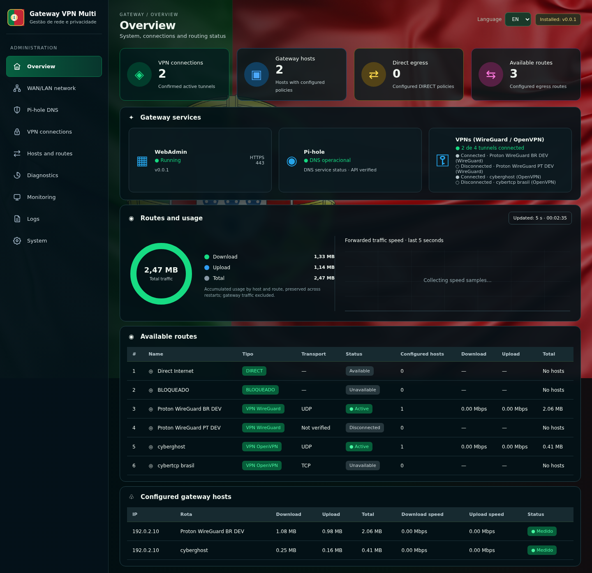
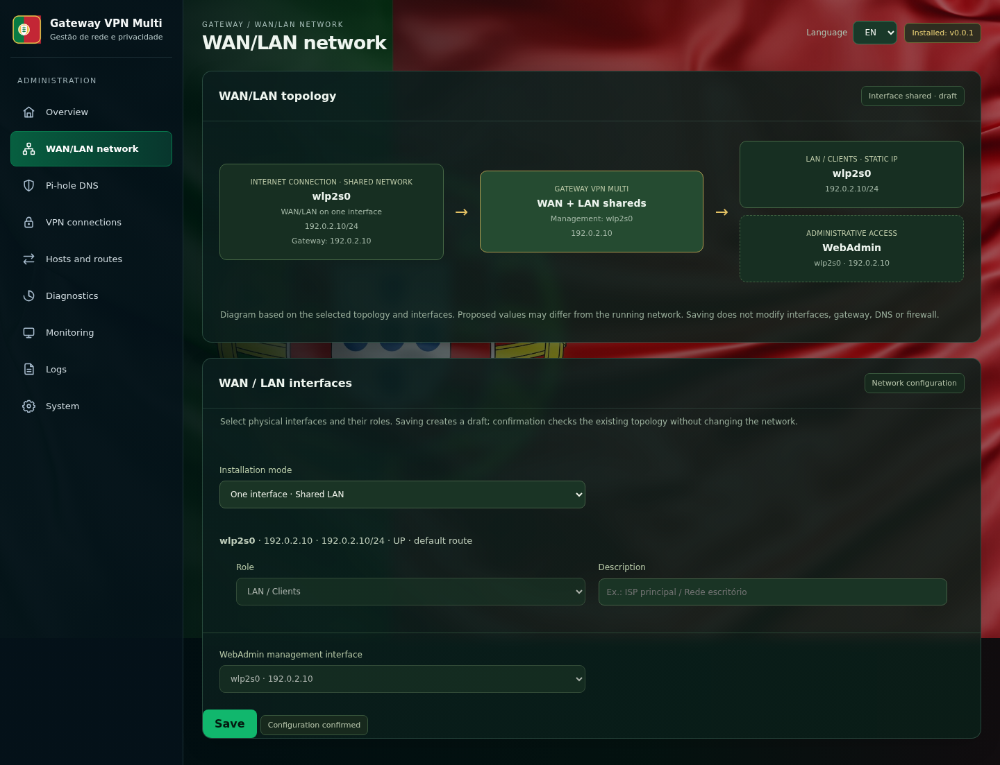
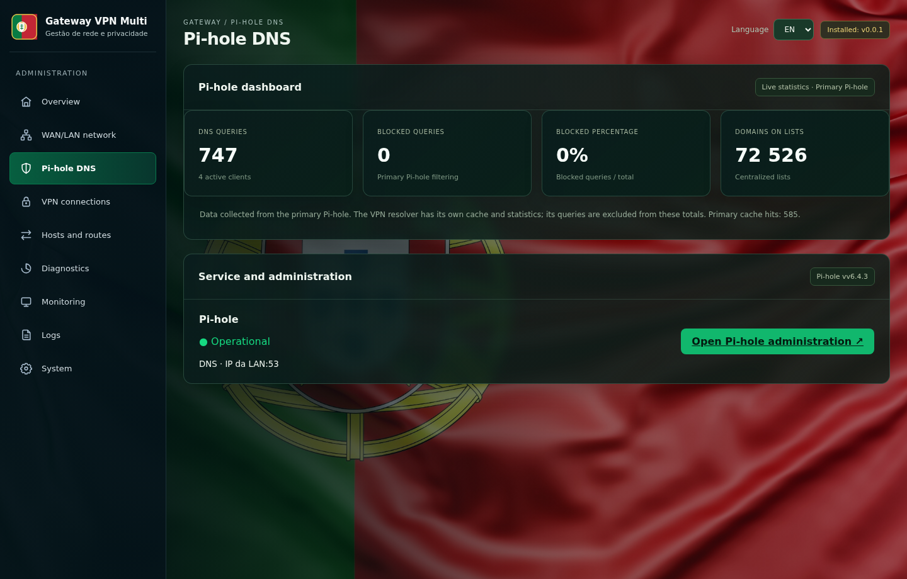
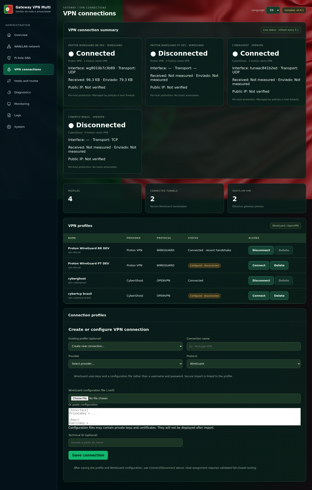
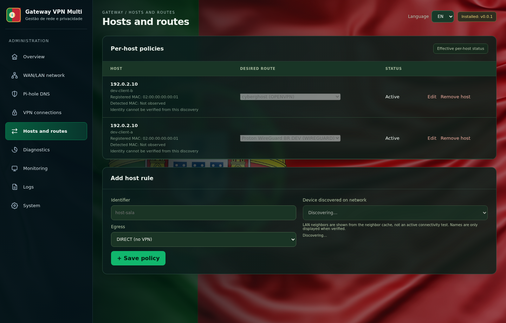
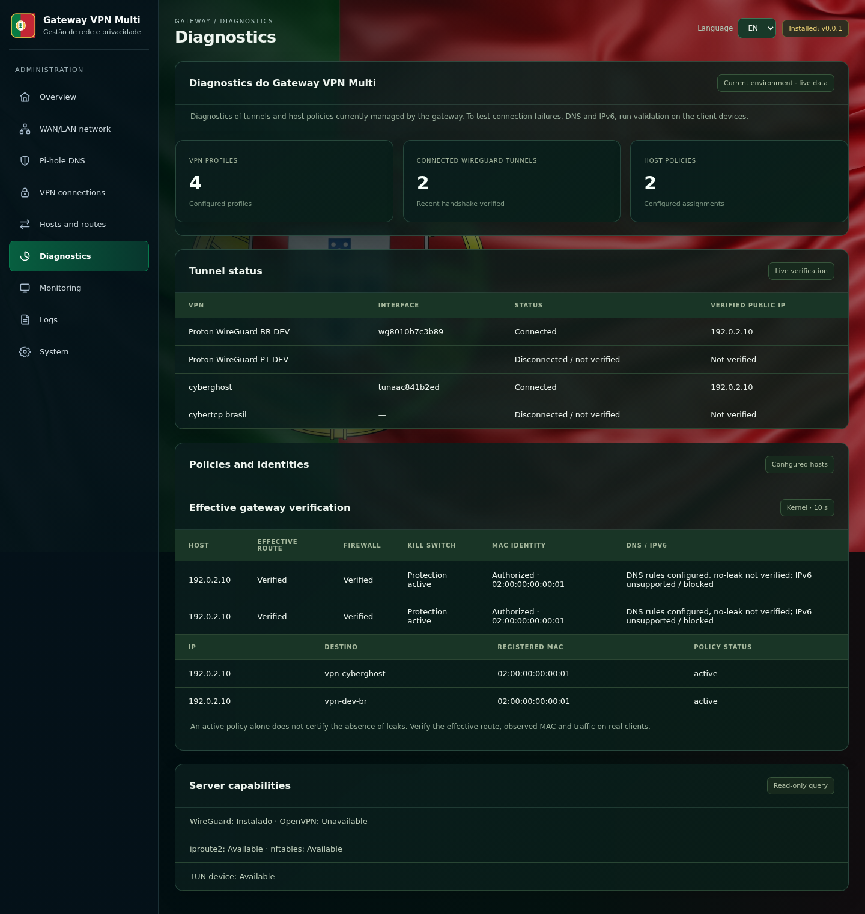
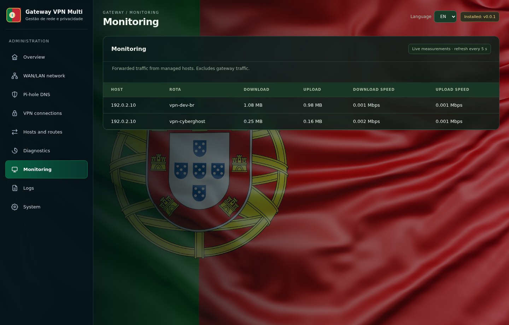
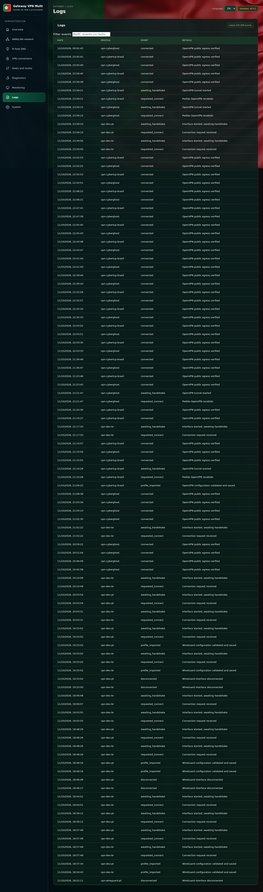
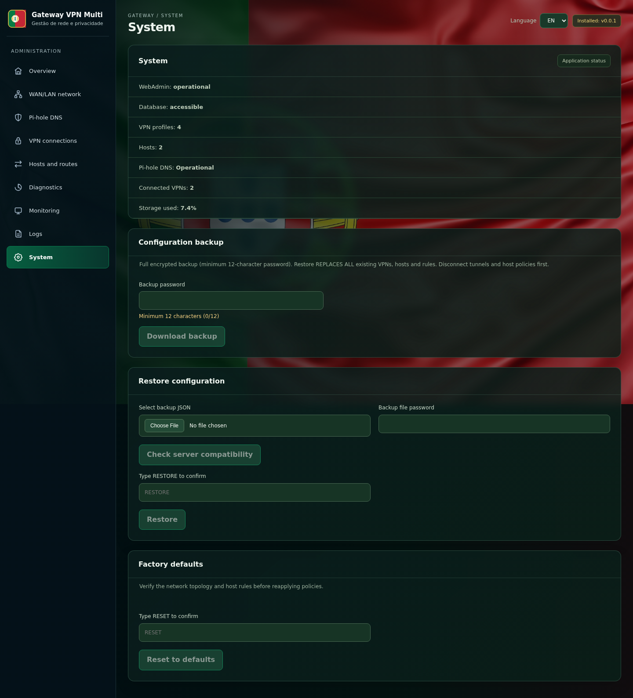

<div align="center">

# Gateway VPN Multi

### Linux IPv4 multi-VPN gateway with per-device routing, Pi-hole and a bilingual WebAdmin

     [](LICENSE)

**Securely route each managed LAN device through its own VPN profile, DIRECT access, or a fail-closed BLOCKED policy.**

[Features](#features) · [Screenshots](#webadmin-gallery) · [Architecture](#architecture) · [Installation](#installation) · [Security](#security-model) · [Recovery](#backup-and-recovery)

</div>

---

<p align="center"></p>

## Features

| Area | Capabilities |
|---|---|
| **Per-host IPv4 routing** | Independent device policies: WireGuard, OpenVPN, DIRECT or BLOCKED; no VLAN requirement. |
| **Multiple VPN profiles** | Import WireGuard `.conf`, OpenVPN profiles and credentials/certificates; connect and monitor tunnels independently. |
| **Fail-closed security** | Host-scoped policy routing, nftables/iptables guards, kill-switch behavior and timed transitions with rollback. |
| **MAC identity checks** | Bind a registered MAC to an IPv4 host and flag a mismatch before association or route updates. |
| **LAN discovery** | Discover clients on interfaces assigned the LAN/client role and avoid duplicate concurrent discovery jobs. |
| **WAN/LAN modes** | One shared WAN/LAN interface or separate WAN/LAN interfaces; optional additional LAN interfaces. |
| **Pi-hole DNS** | Integrated administration and statistics, VPN-scoped DNS NAT and TCP/UDP port-53 restrictions. |
| **Monitoring** | Tunnel handshakes, public IPv4 probes, route/firewall diagnostics, traffic accounting and VPN event logs. |
| **Backup and restore** | Encrypted AES-256-GCM export, compatibility preflight, interface mapping and confirmed restoration. |
| **Factory defaults** | Explicitly reset managed VPN/host state while retaining the administrative network configuration. |
| **PT/EN WebAdmin** | English and Portuguese UI; static translation regression check included in the build. |
| **Linux installer** | Automated `start.sh` deployment using Docker Compose and persistent systemd host agents. |

## WebAdmin gallery

Screenshots were captured from the running WebAdmin in English and anonymized for publication. The example IP/MAC values in the images are not installation settings.

| Overview | WAN/LAN network |
|---|---|
|  |  |
| Pi-hole DNS | VPN profiles |
|  |  |
| Host policies | Diagnostics |
|  |  |
| Monitoring | Logs |
|  |  |
| System: backup, restore and factory defaults | |
|  | |

## Architecture

```text
                    Administrator / Browser
                       HTTPS management
                               |
                        nginx + WebAdmin
                      React / TypeScript
                               |
                          Python API
                       SQLite configuration
                               |
              authenticated local agent interfaces
                      /                 \
             Policy agent          OpenVPN agent
             (systemd)            + VPN services
                      \                 /
                 Linux policy routing + nftables
                               |
                    LAN interface(s) + MAC guard
                               |
          +--------------------+-------------------+
          |                    |                   |
       Host A                Host B            Other hosts
          |                    |                   |
       WireGuard              OpenVPN         DIRECT/BLOCKED
          |                    |
       VPN DNS               VPN DNS

               Pi-hole (Docker Compose)
                DNS filtering / statistics
```

**Control plane.** A React/TypeScript browser application uses the Python API behind HTTPS nginx. Configuration and administrative state are persisted in SQLite. Privileged networking is delegated to local Linux agents.

**Data plane.** Each managed client gets an independent Linux policy-routing table and firewall rules tied to its IPv4 address, authorized MAC and intended tunnel. DNS IPv4 can be redirected to the corresponding VPN resolver, with port-53 guards.

**Lifecycle.** Docker Compose hosts WebAdmin, HTTPS and Pi-hole services. systemd manages privileged policy recovery and VPN startup from stored profiles. Only VPNs assigned to active host policies need to reconnect at boot.

## Installation

### Requirements

Linux with systemd and administrative access, a private LAN IPv4 address, and clients configured to use this machine as their IPv4 gateway. Debian/Ubuntu systems can have missing dependencies installed automatically. Docker Engine, Compose v2, WireGuard, OpenVPN, nftables, iproute2, Python 3 and OpenSSL are used.

```bash
git clone https://github.com/emmanique/vpngateway-webadmin.git
cd vpngateway-webadmin
./start.sh --check
sudo ./start.sh
```

Explicit management interface:

```bash
sudo ./start.sh --lan-interface enp2s0 --lan-ip 192.168.50.2
```

| Service | Default URL |
|---|---|
| WebAdmin | `https://<gateway-lan-ip>/` |
| Pi-hole administration | `https://<gateway-lan-ip>:8443/` |

The launcher discovers the management IPv4, installs local agents, prepares a self-signed TLS certificate and Pi-hole secret, and deploys the containers. For routine upgrades, rerun `sudo ./start.sh` rather than deleting persistent volumes. Never commit `deploy/.env`, VPN private keys, certificates, credential files or backup archives.

## Configuration workflow

1. Confirm interface roles under **WAN/LAN network**.
2. Discover clients in **Hosts and routes** and verify their registered IPv4/MAC identities.
3. Create a VPN profile and import the WireGuard or OpenVPN configuration **once**.
4. Connect the VPN and inspect its tunnel/handshake state.
5. Activate a restored draft host in BLOCKED mode if needed; apply the VPN transition and confirm within the rollback window.
6. Validate the client's external IPv4 and DNS, and inspect **Diagnostics**, **Monitoring** and **Logs**.

VPN names, providers and client IPs are configurable rather than hard-coded.

## Security model

- **Fail closed:** loss of an assigned tunnel must never silently switch a managed host to DIRECT.
- **Identity enforcement:** mismatched MAC addresses are rejected/reported rather than reassigned automatically.
- **LAN-only administration:** sensitive configuration changes require same-origin HTTPS on the administrative LAN.
- **DNS IPv4:** standard TCP/UDP port 53 is redirected/guarded per tunnel. Application-level DoH/DoT requires separate client-side enforcement.
- **Shared-LAN caveat:** a client that can reach an upstream router directly without traversing the gateway may bypass this gateway's controls.
- **IPv4-only:** IPv6 routing and Windows installation are **not supported** in this version.

## Backup and recovery

**System → Backup** exports encrypted configuration using AES-256-GCM and a password of at least 12 characters. It includes managed VPN profile files and material, administrative tables and host policies.

**System → Restore** first checks topology compatibility and interface mapping, then performs an explicitly confirmed restore. Policies are restored as drafts/inactive for deliberate reactivation; VPN credentials need not be reimported.

**System → Factory defaults** removes managed VPN profiles and host policies after explicit confirmation, while preserving network management settings. Always export a backup first.

Boot recovery reloads confirmed policy rules and reconnects the VPN profiles used by active managed hosts. If the tunnel cannot be recovered, host traffic remains blocked.

## Observability and quality checks

Kernel route verification, MAC/firewall guards, public IPv4 tunnel probes, per-host traffic measurements and event logs are exposed through WebAdmin. The translation checker runs in every frontend build:

```bash
cd apps/web
npm ci
npm run i18n:check
npm run build
```

New static labels require English mappings; duplicate legacy translations and PT/EN key mismatches fail the check. Dynamic messaging still merits UI-level regression tests in both languages.

## Project structure

| Path | Purpose |
|---|---|
| `apps/web/src/` | React interface, translations, styles |
| `apps/web/tools/` | i18n validation |
| `apps/api/` | Python API, SQLite and encrypted system maintenance |
| `scripts/vpngw-policy-agent.py` | Host firewall/routing, kill switch and boot recovery |
| `scripts/vpngw-openvpn-agent.py` | OpenVPN lifecycle |
| `deploy/` | Compose and HTTPS manifests |
| `installers/` | Linux agent installation |
| `start.sh` | One-command installation and update entry point |
| `screenshots/` | Anonymized WebAdmin gallery |

## License

MIT — see [LICENSE](LICENSE).

---

<div align="center">

### Gateway VPN Multi

**Self-hosted. Per-host. Multi-VPN. Fail-closed.**

</div>
